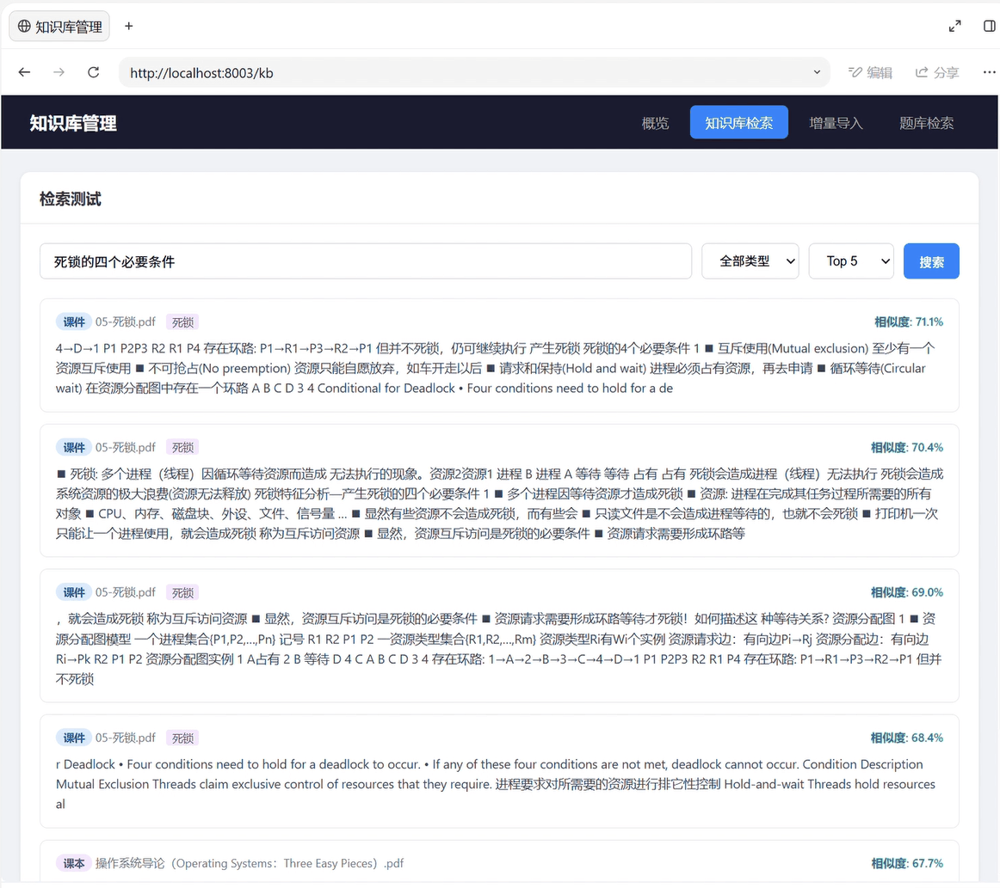
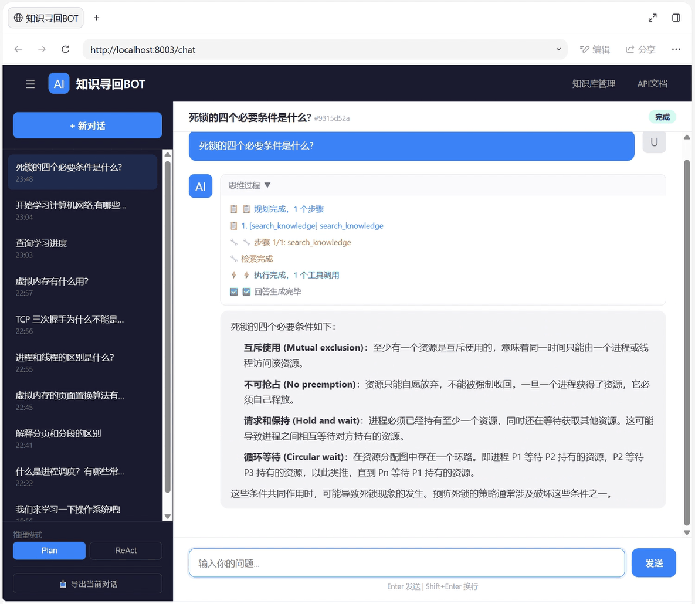
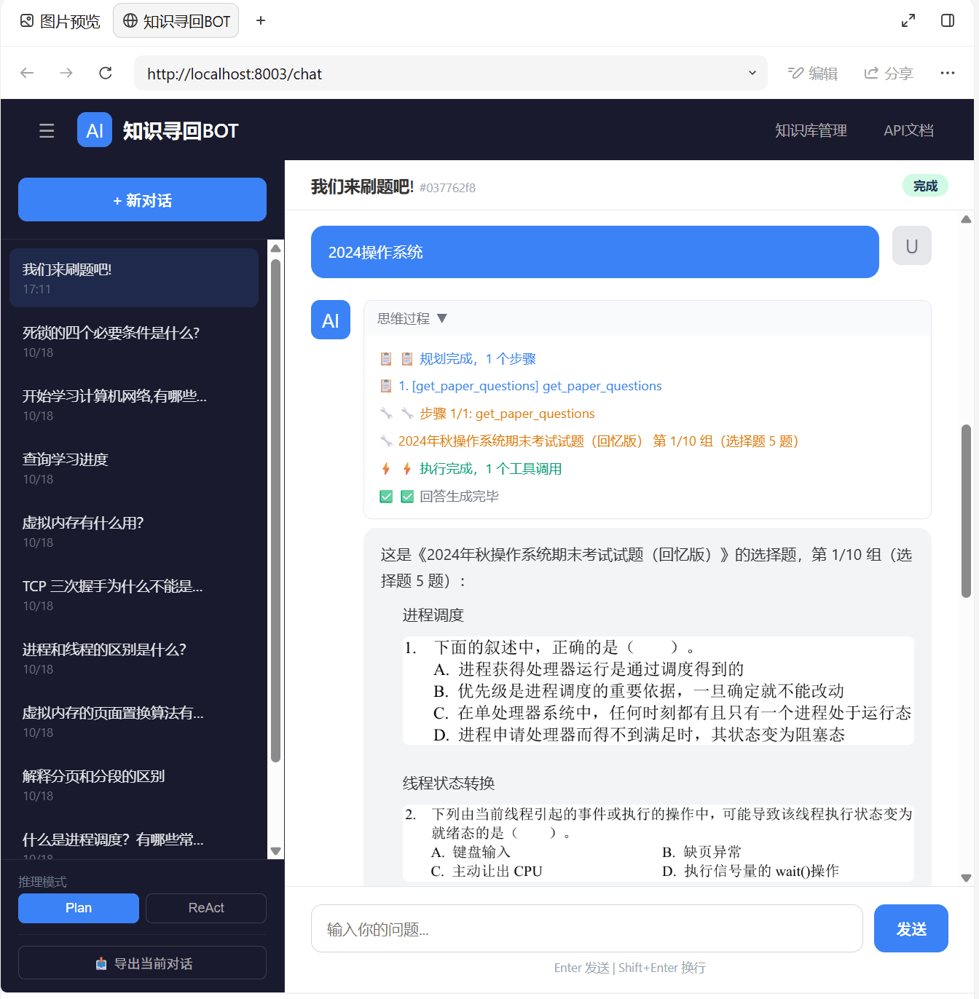
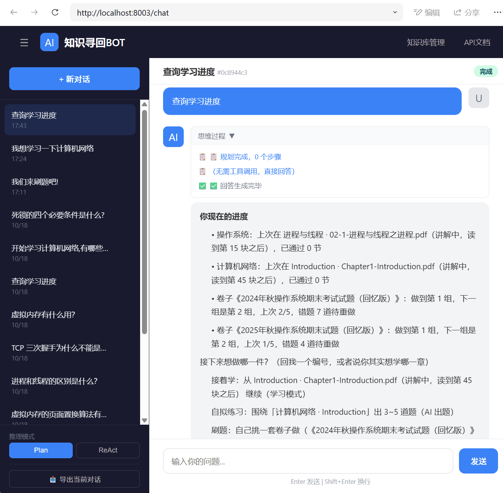
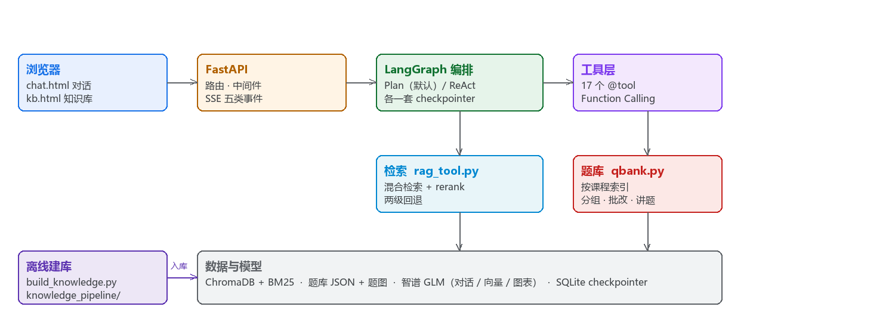
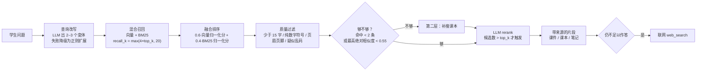

# 知识寻回BOT —— 课程资料变成会讲课、会出题、会批改的助教

> 把课件、课本、历年真题 PDF 变成一个真能用的课程助教：按章节讲、分组出题、批改、讲题、记进度，讲不清就联网查。

面向期末周被课件看不完、真题没答案、错题没人讲问题困扰的朋友们：

- 说「我要复习操作系统」→ 逐章节讲解，讲完通过章末小测验证学习成果
- 说「刷xx年真题卷」→ 从真题库里取题，题号、题图、参考答案都来源题库
- 交答案 → 批改 + 按点讲思路；听不懂就追问，它严格按照课件讲解，课件没有就翻课本，最后联网保底
- 换个窗口回来 → 一句话查询学习进度，接着学

**工程验证**：985 项离线测试 + 107 项前端断言；34 条行为评测用例走真实 HTTP + SSE
（最新归档只覆盖 29 条，另外 5 条还没进过报告）。判据与口径见 [eval/reports/INDEX.md](eval/reports/INDEX.md)。

**技术亮点**

- **Agent 编排**：LangGraph 两张图 —— Plan-and-Execute 与 ReAct，编排层不同、业务逻辑一份
- **RAG**：混合召回（向量 + BM25）→ LLM rerank → 课件 / 课本 / 联网分层回退，课程问题由 guard node 强制先检索
- **工程化**：真实 HTTP + SSE 的行为评测（判据机器可判）、985 项离线测试、CI、Docker 演示镜像

`Python 3.12` · `LangGraph` · `FastAPI` · `ChromaDB` · `rank_bm25` · `GLM-4-Flash` · `Docker`

**目录**

- [Demo](#demo)
- [核心能力](#核心能力)
- [架构](#架构)
- [检索链路](#检索链路)
- [快速开始](#快速开始从零复现)
- [当前状态与已知限制](#当前状态与已知限制)
- [测试与工程化](#测试与工程化)
- [Roadmap](#roadmap)
- [设计取舍](#设计取舍)

---

## Demo

**视频（52 秒）：[demo/demo-full.mp4](demo/demo-full.mp4)**

| RAG 混合检索                                    | 问答：先检索再作答（1 个工具调用）                       |
| ------------------------------------------- | ---------------------------------------- |
|  |  |

| 出题：题号与知识点取自题库                        | 学习进度：学到第几块、刷到第几组                           |
| ------------------------------------ | ------------------------------------------ |
|  |  |

本地启动后访问 `http://127.0.0.1:8003/chat` 直接体验。

---

## 核心能力

| 场景 | 能力 |
| --- | --- |
| 学习与进度 | 按章节讲、书签续读、章末小测、随时不懂就问；跨会话与跨窗口接着上次 |
| 解题 | 分组出题、多种答案格式批改、按点讲解、按知识点抽题、错题重做、自拟练习 |
| 复习 | 知识点速查、针对薄弱环节出题练习 |
| 知识问答 | 先检索再作答；库里没有就两级回退，仍不足则联网 |
| 意图路由 | 一句话切换场景（学习 / 解题 / 复习），不需要手动切模式开关 |
| 知识库 | 上传、路径导入、目录浏览、检索测试、删除；新增课程 = 建一个目录 |


### 技术栈

| 层  | 选型                                                                  |
| -- | ------------------------------------------------------------------- |
| 接入 | FastAPI · SSE 五类事件（`start` / `node` / `content` / `done` / `error`） |
| 编排 | LangGraph：Plan-and-Execute 与 ReAct 两张图，各自独立 checkpointer            |
| 检索 | ChromaDB + BM25 混合融合 → LLM rerank → 两级回退                            |
| 模型 | `glm-4-flash`（对话）· `embedding-3`（向量）· `glm-4v-flash`（图表理解）          |
| 状态 | SQLite checkpointer 持久化 + JSON 进度账本                                 |
| 前端 | 原生 JS，零框架（`chat.html` / `kb.html`）                                  |

---

## 架构



端到端流程：`POST /qa/stream` 进来 → planner 出计划→ executor 按计划调用工具 `@tool`
→ synthesizer 把工具结果写成答案，逐字从 `content` 事件推给前端 → `done` 收尾。

两张图（Plan-and-Execute / ReAct）只在编排层有差别，业务逻辑共用 `course_agent/quiz_service.py`。


**17 个工具**（工具只是薄适配，取题 / 分组 / 批改 / 讲题的逻辑都在 `quiz_service.py` 一份实现里）：

| 场景    | 工具                                                                                                                              |
| ----- | ------------------------------------------------------------------------------------------------------------------------------- |
| 检索与资料 | `search_knowledge` · `web_search` · `get_course_info`                                                                           |
| 学习    | `list_course_sections` · `read_section` · `record_study_position` · `get_learning_progress`                                      |
| 刷题    | `list_papers` · `get_paper_questions` · `grade_answers` · `explain_question` · `get_answers` · `practice_by_topic` · `practice_wrong` · `prepare_custom_quiz` |
| 统计    | `get_practice_stats` · `record_practice`                                                                                        |

**一次完整调用**（取自 `eval/reports/1.11.1.json` 里 `react_no_tool_call_leak` 的一次尝试）

1. 学生问：「给我讲讲死锁的四个必要条件」
2. planner 计划 1 步：`search_knowledge`
3. 同一条查询在检索测试页的返回：2 条命中，都来自课件 `05-死锁.pdf`（融合分 0.70 / 0.67），
   片段里有「死锁特征分析 — 产生死锁的四个必要条件」
4. synthesizer 作答：131 个 `content` 事件逐字推出，首字 6.2s，整轮 12.8s，答案 223 字
5. `done` 收尾，带上完整答案供前端兜底对齐

答案摘录（原样，未润色）：

> 死锁的四个必要条件是：① **互斥使用**：至少有一个资源是互斥使用的，即同一时间只能由一个进程或线程访问该资源。
> ② **不可抢占**：资源只能自愿放弃，不能被强制抢占。③ **请求和保持**：进程必须占有资源，在执行过程中再去申请其他资源。
> ④ **循环等待**：在资源分配图中存在一个环路……这些条件必须同时满足，才能产生死锁现象。

---

**工程防线**：

| 防线    | 做法                                                              |
| ----- | --------------------------------------------------------------- |
| 防失控   | 工具调用轮数硬上限；guard node 强制课程问题先检索，不许凭模型记忆作答                        |
| 上下文治理 | 读时裁剪、摘要缓存按消息 id 摊还、tool 消息与 `tool_calls` 严格配对                   |
| 不泄漏   | SSE 正文四层判据（来源白名单 + 内部调用标签 + 类型白名单 + 非空），工具返回原文不进正文频道            |
| 路径安全  | 所有文件操作 `resolve()` + `relative_to(data/)`，防线设在 API 边界而非库层       |
| 可观测   | `contextvars` 存 `trace_id` 贯穿中间件 / 日志 / 错误处理；三层错误模型 + 指数退避 + 降级 |

模块分工、路由清单、层间依赖、两条数据线的构建链路：见 [docs/architecture.md](docs/architecture.md)。

---

## 检索链路



| 环节  | 关键参数               | 为什么是它                                              |
| --- | ------------------ | -------------------------------------------------- |
| 分块  | 300 字 / 重叠 50      | 课件一页大约 2–3 块：够上下文，又不把 rerank 的候选预算吃满               |
| 召回  | `top_k×4`，最少 20 条   | 给 rerank 留候选；查询变体分别召回后按文本去重                        |
| 融合  | 0.6 向量 + 0.4 BM25  | BM25通过关键词检索，向量通过语义检索                   |
| 够不够 | 绝对余弦 < 0.55 就补搜课本  | 融合分按本次最大值归一化，排名第一恒 ≥ 0.6|
| 回退  | 课件 / 笔记 → 课本 → 联网 | 一切以课件为准，课本兜底，联网最后                                  |


---

## 快速开始（从零复现）

### 0. 前置

| 需要         | 要求         | 为什么                                                     |
| ---------- | ---------- | ------------------------------------------------------- |
| Python     | **3.12.x** | 锁文件按 3.12 生成；3.13 有包缺 wheel，3.11 会静默降级依赖                |
| Git        | 任意版本       | 也可以直接下 ZIP（解压后**多一层目录**，别踩）                             |
| 磁盘         | ≥ 300 MB   | 课件 + 向量库；课件不入库，需自备                                      |
| 智谱 API Key | —          | 免费申请约 2 分钟：[docs.bigmodel.cn](https://docs.bigmodel.cn) |

### 1. 拿到代码并建虚拟环境

```bash
git clone <仓库地址> ai-agent-learning && cd ai-agent-learning

python -m venv .venv
.venv\Scripts\activate          # Windows
source .venv/bin/activate       # macOS / Linux

pip install -r requirements.lock
```

> **别跳过 venv。** 用系统 Python 装，很容易和别的项目的 `chromadb` / `pydantic` 版本打架，
> 而报错都是"import 失败"，极难定位。锁文件保证你装出来的和 CI、镜像完全一致。

### 2. 配置 Key

```bash
cp .env.example .env      # Windows: copy .env.example .env
```

打开 `.env`，**只需填一行**：

```
ZHIPU_API_KEY=你的key
```

其余全部可选：`API_KEY` / `JWT_SECRET`（鉴权，本地不用）、`RATE_LIMIT_PER_MINUTE`（限流）、
`PROGRESS_FILE`（学习进度文件，演示时用它隔离真实进度）。

### 3. 准备课程数据

> **只想先看看效果？** 用 [Docker 演示镜像](#docker) 可以跳过第 3、4 步。

课件 PDF、试卷 PDF、题图、题库 JSON、向量库**都不入库**（版权 + 体积，合计约 300 MB），需要自己准备。目录结构固定：

```
data/操作系统/ppt/*.pdf          # 课件
data/计算机网络/**/*.pdf
data/<课程>/往年题/*.pdf          # 试卷，用来生成题库
```

- **想刷题** → 先有题库：`python -m course_agent.question_bank data/操作系统/往年题/`
- **想问答** → 放好课件，跑第 4 步建库
- 题图缺失时，出题那一轮会没图（题库 JSON 里有引用，但文件不在）—— 这是预期，不是 bug

### 4. 建库（一次性）

```bash
python build_knowledge.py --clear --skip-textbook
python build_knowledge.py --stats        # 验证：分块数必须 > 0
```

- 会按批调用 embedding，**消耗额度**，全量约 20 分钟
- `--skip-textbook` 跳过三本课本（最慢的部分）；要全量就去掉它
- 想先快跑通：`--data-dir ./data/操作系统` 只入一门课
- 各步细节（分类 / 分块 / VLM / md5 增量）见 [docs/architecture.md](docs/architecture.md)

### 5. 启动

```bash
python -m uvicorn course_agent.server:app --port 8003
```

| 入口     | URL                          |
| ------ | ---------------------------- |
| 聊天页面   | <http://127.0.0.1:8003/chat> |
| 知识库管理  | <http://127.0.0.1:8003/kb>   |
| API 文档 | <http://127.0.0.1:8003/docs> |

### 6. 怎么确认"真的跑对了"

```bash
python -m pytest tests/ -q          # 全离线；缺数据的用例 skip 而不是报红
curl http://127.0.0.1:8003/health   # knowledge_chunks > 0 = 库建好了

curl -N -X POST http://127.0.0.1:8003/qa/stream \
  -H 'Content-Type: application/json' \
  -d '{"query":"进程和线程的区别","mode":"plan"}'
  # 看 content 是否逐字出现；整段一次性出现 = 流式没生效
```

### 7. 起不来？先查这五条

| 现象                                | 大概率原因                    | 解法                               |
| --------------------------------- | ------------------------ | -------------------------------- |
| `import` 失败 / pydantic 版本冲突       | 没在 venv 里装               | 删 `.venv` 重来，确认命令行有 `(.venv)` 前缀 |
| `/health` 里 `knowledge_chunks: 0` | 没建库 / `--data-dir` 指错    | 重跑第 4 步                          |
| 问答报 401 或额度错误                     | `.env` 里 Key 没填、填错行、带了引号 | 只留 `ZHIPU_API_KEY=xxx` 一行        |
| 端口 8003 被占                        | 上一次的服务没关                 | 换 `--port 8004`，或关掉旧进程           |
| 出题没有图                             | 题图未入库（`.gitignore`）      | 属预期，见第 3 步                       |

### Docker

仓库带两份构建文件，用途不同：

| <br />     | 演示镜像                                            | 完整部署                             |
| ---------- | ----------------------------------------------- | -------------------------------- |
| 构建文件       | `Dockerfile.demo` + `docker-compose.demo.yml`   | `Dockerfile`                     |
| 数据         | 挂 `demo/seed/`（5 份笔记 + 11 道题 + 预建向量库） | 挂用户自己的 `data/` 与 `vector_store/` |
| 需要 API Key | 不需要真实 Key：填个占位值即可（导入期要求非空），向量库已预建、不调 embedding | 需要，建库要调 embedding                |
| 用途         | 别人 clone 下来一条命令就能看到检索与刷题在工作                     | 装自己的课件，当日常工具用                    |

演示镜像：

```bash
cp .env.example .env        # 先建 .env：compose 用 env_file，Key 填占位值即可
docker compose -f docker-compose.demo.yml up -d --build
```

起来就能看 `/chat`。`demo/seed/data` 只读，所以 `/kb/add`、`/kb/upload` 会失败（故意）；`vector_store` 必须可写；
删掉 `demo-runtime` 卷就清空演示状态。

完整部署用 `Dockerfile`，自己挂 `./data` 与 `./vector_store`（这份编排不随仓库分发）；
**宿主机要先建过库**，否则 `/health` 的 `knowledge_chunks` 是 0。

---

## 当前状态与已知限制

| 指标        | 当前                                      | 口径                                                        |
| --------- | --------------------------------------- | --------------------------------------------------------- |
| 版本        | **v1.11.2**                             | `config.py` 的 `APP_VERSION`，与 git tag、GitHub Release 三方对齐 |
| 首字响应 TTFT | **7.5s**（p50）/ 16.6s（p95）               | 1.11.1 归档，真实 HTTP + SSE + 真模型                             |
| 单轮总时长     | 24.2s（p50）                              | 1.11.1 归档                                                 |
| 行为评测      | 判据 **900 / 903** 通过；29 条用例中 **26 条稳定**  | 每用例 3 次尝试，判据全部机器可判                                        |
| 补搜提示准确率   | 域内/域外 12 条样本 **12/12**                  | 1.7.x 时期修的单项，之后未重测                                        |
| 测试        | **985** 项 pytest + **107** 项前端断言 + 服务探活 | CI 每次 push 自动跑                                            |

> 当前代码是 **v1.11.2**，上表指标来自 **1.11.1** 归档；1.11.2 之后没有重跑评测。

**性能优化前后**

| 优化                          | 前                                  | 后                            | 口径 / 证据                       |
| --------------------------- | --------------------------------- | ---------------------------- | ----------------------------- |
| 逐字流式（1.7.1 → 1.7.2）        | 33s 才出字（当时首字 ≈ 整轮时长）              | 6.5s p50，`content` 517–613 个/轮 | **历史批量评测**：1.7.1 / 1.7.2 两份报告 |
| 出题轮不逐字流式 + 图由代码按题号补（1.11.x） | 33.6s，且逐字刷出半截图 URL 与坏图            | 9.8s                        | **单次实测**：CHANGELOG 记录，非统计值   |
| 当前                          | —                                 | 7.5s p50 / 16.6s p95、单轮 24.2s | **当前归档**：1.11.1 报告（29 条 × 3 次） |

**已知技术问题**

1. 文档解析只有文本层：没有 OCR，也没有表格结构识别，扫描件和复杂表格会退化。题库用"每题裁一张图"解决这个问题
2. 首响 7.5 秒（p50）—— 课程问题优先参考课件，先检索再作答需要时间
3. ReAct 偶发"嘴上说要调工具、实际没调"：已补一轮强制调用，残留是流式打字时可能闪过一下工具调用原文。
   根治要给 SSE 加回退缓冲，那会让流式变粗，所以保留现状
4. 讲得好不好没有度量：34 条判据只管"该调的工具调了没、该出现的出现没"，不管"讲得清不清楚"
5. 评测要真模型、真额度，因而不进 CI：报告只能手动跑完归档，做不到每次提交自动更新

**当前产品边界**：只覆盖操作系统 / 计算机网络两门课 —— 加课要按 `data/<课程>/` 准备资料，见「设计取舍」。

---

## 测试与工程化

**评测怎么做的**（用例与判据的完整说明见 [eval/README.md](eval/README.md)）：

| 问题      | 做法                                                                                    |
| ------- | ------------------------------------------------------------------------------------- |
| 用例从哪来   | 只用**真实缺陷**或**真实需求**，每条必写 `why`；`turns` 脚本化，多轮共用同一个 `thread_id`                              |
| 判据怎么判   | 全部机器可判：该调的工具调没调、题面与参考答案有没有泄进正文、图是不是都来自题库、首字数够不够、正文有没有出现内部产物（计划 JSON / 工具调用原文） |
| 怎么算"稳定" | 每条跑 3 次，3/3 通过才算稳定 —— 历史上的缺陷全是时好时坏，单次通过没有意义                                             |
| 怎么证明判据有效 | 变异验证：把代码故意改坏，对应用例必须变红；改判据要在报告里登记理由                                                     |

```bash
# 评测走真实 HTTP + SSE + 真模型，所以要先起服务，并会消耗额度（不进 CI）
python -m eval.runner                        # 全部用例 × 3 次
python -m eval.runner --case quiz_no_leak    # 单条
```

> 跑评测时别同时跑 `pytest`（会撞「真实会话库不许变脏」那条守卫）；需要预置学习进度的用例要先设 `PROGRESS_FILE`。

- **测试四层**：单元测试（外部依赖全 mock）/ 接口契约测试 / 历史 bug 回归 / 架构守卫（依赖方向、图隔离、
  锁文件同步、26 条路由的端点清单）

- **三条环境守卫**（session 级）：真实会话库不被测试写入、真实 `data/` 不被测试改动、服务运行中拒绝开跑
  （防 Chroma 并发写损坏）

- **数据可用性**：课件、试卷、题库、向量库都不入库，依赖缺失的用例自动 skip 而非报红，新克隆即可跑通
  （刷题相关的用例除外）

- **CI**：GitHub Actions 每次 push 跑 pytest + 前端断言（`tests/js/*.mjs`）+ 服务冒烟；
  `txt / lock / 环境`三方一致性有测试守着

- **可复现交付**：锁文件用 `uv pip compile --universal`（带 `sys_platform` 标记，Windows/Linux 同一份）→
  CI 与镜像都从它装；镜像分层先依赖后源码（改代码不触发重装）；`vector_store/` 与 `data/` 走 volume
  （重建要耗 embedding 额度）；healthcheck 用 `python -c requests` 而非 `curl`（slim 镜像里没有 curl）

- **压测**：Locust 三级虚拟用户（只读 / 检索 / 问答），问答级默认关闭防烧额度

> 测试数与首响口径的唯一定义在 [eval/reports/INDEX.md](eval/reports/INDEX.md)；
> 路由与工具数在 [docs/architecture.md](docs/architecture.md)。

---

## Roadmap


- [ ] **重跑 34 条用例、归档当前版本报告** —— 最新归档停在 1.11.1（29 条），另有 5 条从未进过报告
- [ ] 检索质量对照实验：同一批问题 + 同一套相关文档标注，比三种配置的 Recall@K / MRR 与耗时 ——
      A 纯向量 / B 向量 + BM25 / C 混合 + rerank
- [ ] 首响：把 planner 与检索的串行耗时压下来，目标 p50 < 5s
- [ ] ReAct 与 Plan-and-Execute 同题对比：token / 轮次 / 准确率 / 失败模式分类
- [ ] 给知识库分块加 `course` 元数据，去掉"按文件名反查课程"这层耦合
- [ ] 新增课程后能在 Web 上传试卷 PDF 并生成题库
- [ ] 判定“讲得好不好”：把技术问题 4 变成数字 —— LLM 裁判 + 人工标注校准，先拿 10–20 条对齐再当参考值
- [x] 全局学习进度、刷题位置记忆与错题本 —— 1.8.0 / 1.9.0 已交付


---

## 设计取舍

- **题库用历年真题，不用模型自拟题** —— 复习阶段刷真题对考试最有效；模型自拟的题没有权威答案，
  且无法拟合该校出题风格。代价：用户需要自行搜集上传本校真题
- **状态放在模型之外** —— 出题结果、题图、学习进度都存在显式状态与服务端账本里，不指望模型从对话里记住。
  代价：单用户假设，测试与评测必须能把账本隔离掉
- **出题轮不逐字流式** —— 那一轮正文是百分号编码的图 URL，逐字推出去就是半截URL和坏图；
  改成只发进度、`done` 一次给全。代价：用户需焦急等待出题
- **课程清单查目录，不写死在代码里** —— 新增一门课 = `mkdir data/<课程>/`。代价：课程识别依赖目录真实存在，
  所以那类行为用例要自带假课程目录，不能依赖本机数据
- **两条图都留在产品里** —— 为了对比学习 Plan-and-Execute 与 ReAct：业务逻辑共用一份，差别只在"谁决定下一步"；
  界面上可切换，同一个问题换个模式就是对照实验。代价：两套提示词与 checkpointer
- **手写循环冻结进 `frozen/`** —— 第三种实现。5 个场景与 LangGraph 那条等价（16 好/3 坏 对 18 好/2 坏），
  遂撤掉入口，只留模块与测试当参照物。代价：1268 行不演进的代码

更细的来龙去脉（逐字流式在生产里从未生效、题库加载少了一半、Plan 图编造题目）见
[docs/design-decisions.md](docs/design-decisions.md)；评测细节见 [eval/README.md](eval/README.md)。
